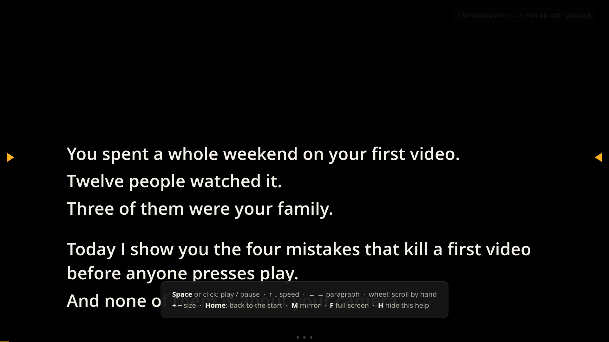

# prompter

Turn a Markdown script into a full-screen teleprompter on your second monitor, with one command.

```
prompter episode-1.md
```



Made for recording voice-overs and talking-head videos with a small monitor placed above or below
the main screen. No app to install, no account: a single Python file that opens a dedicated browser
window, full screen, on the right monitor.

## What it does

- **Cleans the script for reading.** Headings, cue lines such as `**[Intro]**` or `[B-roll]`, and the
  prep notes above the first `---` are removed. Bold, links and code marks are stripped. Each sentence
  gets its own line, paragraphs are spaced for breathing, and a faint `• • •` marks each new section.
  The words you read are exactly the words of your script.
- **Opens on the right screen.** It finds your external monitor (GNOME through Mutter, other X11
  desktops through `xrandr`) and opens a full-screen window there. Pick another one with
  `--screen DP-2` or by model name, `--screen ARZOPA`.
- **Scrolls at your speaking pace.** Speed is set in words per minute, not in pixels, so it stays
  right when you change the text size. The time left is shown on demand.
- **Stays out of the way.** Black background, a reading line marked by two arrows, text already read
  dims, the cursor hides itself, the screen does not go to sleep. Speed and text size are remembered
  per script.

## Keys

| Key | Action |
| --- | --- |
| Space or click | Play / pause, with a 3 second countdown before it starts |
| ↑ / ↓ | Faster / slower (10 words per minute per step) |
| ← / → | Previous / next paragraph, handy to redo a take |
| Mouse wheel | Scroll by hand |
| + / − | Text size |
| Home / End | Start / end of the script |
| M | Mirror (for a beam-splitter glass) |
| N | Narrow column: 3 or 4 words a line, reading line near the top, so your eyes barely move |
| F | Toggle full screen |
| H | Show or hide the help |

Close the window with Alt+F4.

## Install

Needs Python 3.10+ and a Chromium-based browser (Brave, Chromium, Chrome or Edge). Linux only for now.

```
git clone https://github.com/emoubarak/prompter.git
cd prompter
./install.sh          # links prompter into ~/.local/bin
```

## Options

```
prompter script.md                  open on the external monitor
prompter script.md --screen DP-1    pick a monitor (connector or model name)
prompter script.md --wpm 140        starting speed
prompter script.md --narrow        narrow column near the lens
prompter script.md --text           also write the cleaned script to script.prompter.txt
prompter script.md --no-open        only build the page
prompter script.md --lang fr        interface in French (or set PROMPTER_LANG=fr)
prompter script.md -- --kiosk       extra flags passed to the browser
```

`PROMPTER_BROWSER` picks the browser command. The page and the browser profile live in
`~/.local/share/prompter/`, apart from your usual browser profile.

## Writing a script

See [examples/sample.md](examples/sample.md). Anything above the first `---` (if it comes in the
first 15 lines) is treated as notes to yourself. Put a cue on its own line in brackets to mark a
section for the edit: it is hidden from the prompter and becomes a section break.

```markdown
# Episode 1

Notes for me: B-roll list is in the shot doc.

---

**[Hook]**

You spent a whole weekend on your first video. Twelve people watched it.
```

## Notes on Wayland

Wayland does not let an app choose where its window goes, so on a Wayland session prompter starts
the browser through Xwayland (`--ozone-platform=x11`), which does. It also avoids flicker on some
60 Hz USB-C monitors placed next to a high refresh rate laptop screen.

## Tests

```
python3 -m unittest discover -s tests
```

## License

MIT
